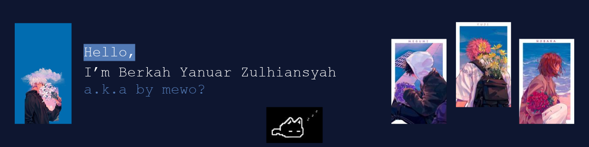

  

  
  
  

---

## ✦ About Me

I'm **Berkah Yanuar Zulhiansyah**, a students at **Institut Teknologi Bandung**. I am a passionate coders

- 🔐 Interested in **React Native, Matplotlib, Expo Go**.
- 🐍 Building with **Python and Javascript**.
- 🐧 Learning through **build your own x**.
- ⚙️ Enjoy building an interactive gamified web app.

## ✦ GitHub Analytics

  
  

## ✦ Tech Stack & Tools

  

---

## ✦ Contribution Arcade

  <picture>
    <source media="(prefers-color-scheme: dark)" srcset="https://raw.githubusercontent.com/berkahyanz17/berkahyanz17/galaga-output/galaga-contribution-graph-dark.svg" />
    <source media="(prefers-color-scheme: light)" srcset="https://raw.githubusercontent.com/berkahyanz17/berkahyanz17/galaga-output/galaga-contribution-graph.svg" />
    
  </picture>

